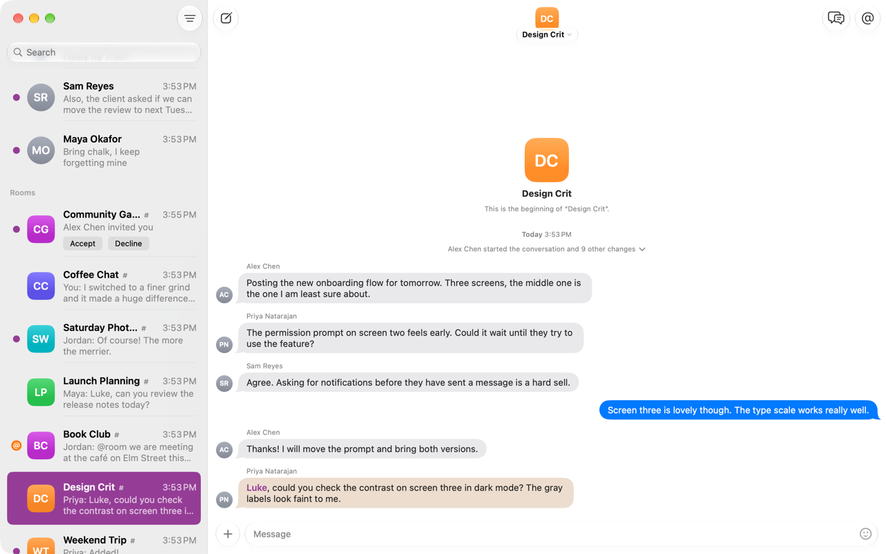
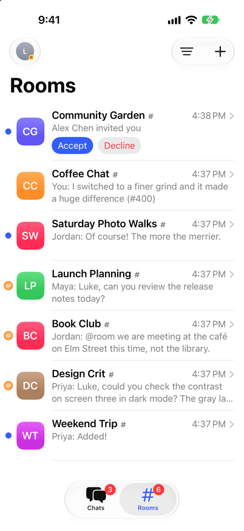
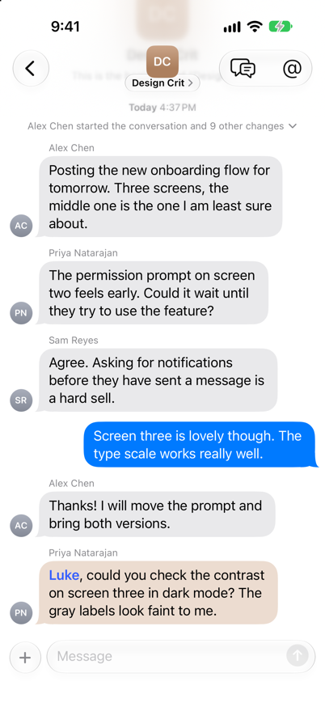
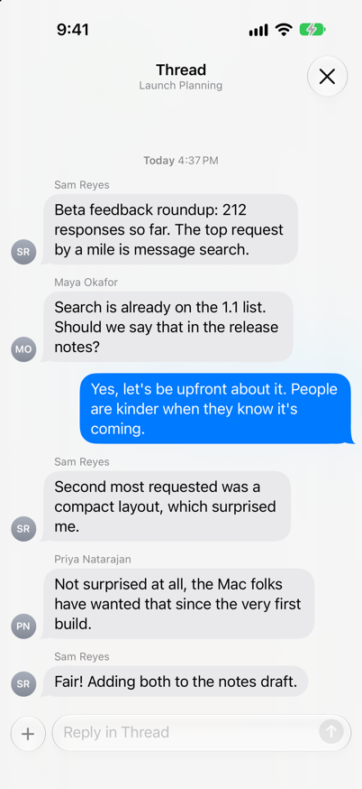
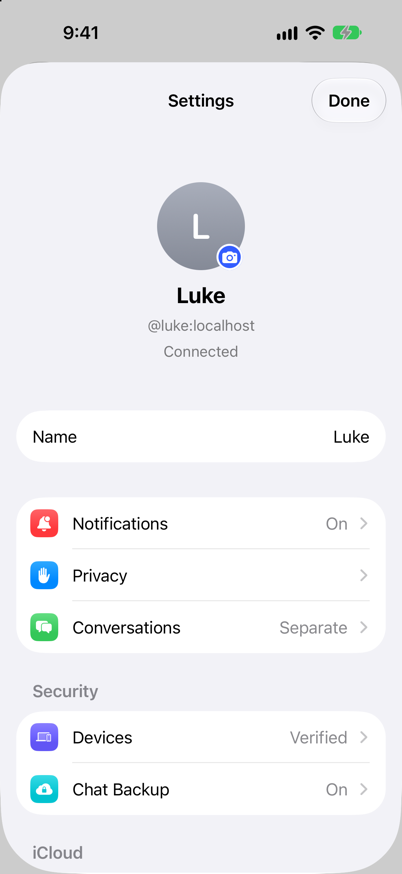

<p align="center">
  
</p>

<h1 align="center">Xenia</h1>

<p align="center"><strong>Matrix made beautiful.</strong></p>

<p align="center">A <a href="https://matrix.org">Matrix</a> messenger for iPhone and Mac, with one Rust engine underneath.</p>

<p align="center">TestFlight here: <a href="https://testflight.apple.com/join/2mnCHzFs">https://testflight.apple.com/join/2mnCHzFs</a></p>

<p align="center">
  <picture>
    <source media="(prefers-color-scheme: dark)" srcset="docs/images/mac-conversation-dark.png">
    
  </picture>
</p>

<p align="center">
  
  
  
  
</p>

The engine, **xenia-core**, is Rust. It signs in, syncs, keeps the conversation list, turns
timelines into ready-to-draw rows, parses rich text, searches an encrypted local index and decides
what deserves a notification. Each platform draws it with its own toolkit: today that's SwiftUI
on iPhone and Mac, and Android, Windows and Linux can follow on the same core (see
[docs/PLATFORMS.md](docs/PLATFORMS.md)).

## Features

- **Chats and Rooms.** Direct conversations in Chats; groups and public rooms in Rooms. Tabs with
  unread badges on iPhone, a sidebar on the Mac (⌘1, ⌘2), or one list for everything (Settings >
  Show Chats and Rooms Together). Each list has its own filter (All, Unread, Pinned) and find
  field, and invitations wait at the top with Accept and Decline in the row.
- **Conversations like Messages.** Bubbles that give as you scroll on iPhone, tails on the last of a run,
  time headers after a pause, big emoji, rich text, mention pills, replies (swipe right on
  iPhone), Tapback-style reactions (double-click or double-tap a message), edits (↑ on the Mac),
  deletes, pins, typing dots, a New Messages line, jump to latest, Delivered and Read.
- **Photos, videos and files** open in Quick Look from the bubble, with every other attachment in
  the conversation a swipe or arrow key away. Photos load over a BlurHash preview, files show
  their kind and size, and audio and voice messages play in the bubble with their waveform. On
  the Mac they drag out to Finder or Mail. Send by pasting or dropping a photo or file on the
  message field (or on a conversation in the Mac sidebar), or with the camera on iPhone.
- **Pins.** Pinned conversations sit above the list as big photos, as in Messages. Drag one to
  reorder them; the order is saved with your account, so every device (and other Matrix apps)
  shows the same one. On the Mac, Control-Tab moves through the list.
- **Threads** open over the conversation, the way Messages opens inline replies, and close back to
  the same place. Every conversation lists its threads (⇧⌘T on the Mac).
- **Your mentions** in a group or room are a click away (⇧⌘M on the Mac): every message that mentions
  you, newest first, from the server and, for encrypted rooms, from this device.
- **Polls**, started from "+": tap a choice to vote, see who chose what, and end the poll if you
  asked. Results can stay hidden until it ends, and a poll can allow several answers.
- **Forward, Copy Link and Report** in every message's menu, and text in a bubble can be selected.
- **Matrix links open in Xenia.** A link to a person opens your chat with them, a room link opens
  or offers to join the room, and a message link jumps to the message. `matrix:` links from other
  apps open Xenia too.
- **Search Everything** (⌘K) finds conversations, people and public rooms on your server, words
  in messages and the app's own actions, all from the keyboard: the server's search for
  unencrypted rooms and a local encrypted index for end-to-end encrypted ones, merged.
- **Search in Conversation** (⌘F) searches one chat back to its very first message, including
  encrypted history this device never downloaded, with filters for who sent it, mentions of you,
  photos, videos, files, links, audio, polls and dates. Typed filters work too: `from:maya`,
  `has:link`, `@me`, `before:2024-05-01`. On the Mac the results sit beside the conversation and
  the arrow keys step through them.
- **Mentions** are suggested as you type "@" (Tab takes one on the Mac), sent as pills with
  `m.mentions`, highlighted when they're about you, and Time Sensitive when they notify.
- **Notifications** that reply and mark as read from the banner, badge the icon, follow your
  settings and keywords, and clear once a conversation is read anywhere. They arrive while Xenia
  is closed: the server pushes IDs only, and a Notification Service Extension decrypts the message
  on the device. On iPhone, pulling one down shows the conversation and lets you reply there.
- **Verification** by comparing emoji with another of your devices or another person. Settings >
  Devices lists every session and verifies, renames or signs out each one.
- **iCloud** keeps settings the same on every device, and with Sign In on Your Other Devices, a new
  Mac or iPhone signs itself in and unlocks with the recovery key from iCloud Keychain.
- **Lock** (iPhone): Require Face ID when you come back, immediately or after a delay, and Hide in
  App Switcher.
- **Shortcuts, Siri and Spotlight**: Send Message, Open Conversation, Search in Xenia, unread
  conversations ("Any new messages in Xenia?") and Mark All as Read as actions. On iPhone, "Send a
  message to Maya on Xenia" works with Siri. Spotlight finds conversations by name, address and
  photo (never their messages), and conversations you write to show up in Siri suggestions.
- **Handoff**: the conversation open on your iPhone continues on your Mac, and back.
- End-to-end encryption, cross-signing and key backup through the
  [Matrix Rust SDK](https://github.com/matrix-org/matrix-rust-sdk).

## Getting started

You need a Mac with Apple silicon, Xcode 27, Rust (through rustup), XcodeGen and Node.
[CONTRIBUTING.md](CONTRIBUTING.md) lists exact versions and setup.

Everything runs against a local test server:

```bash
scripts/dev/homeserver.sh               # Synapse on http://localhost:8008 (installs it the first time)
node scripts/dev/seed-homeserver.mjs    # accounts, rooms, threads, mentions (safe to rerun)
node scripts/dev/seed-long-history.mjs  # optional: "Family", six years of backdated history
cd apple && xcodegen                    # generates Xenia.xcodeproj
open Xenia.xcodeproj                    # run "Xenia macOS" or "Xenia iOS"
```

Debug builds start with `localhost:8008` and release builds with matrix.org. Sign in as `luke`
with the password in `scripts/dev/seed-homeserver.mjs`. The Xcode build compiles the Rust core for
the platform being built: the first build takes a few minutes, later ones take seconds. Build
output lives in `target/`, which can be a symlink to a roomier disk.

To sign with your own Apple developer team, copy `apple/Local.xcconfig.example` to
`apple/Local.xcconfig`, set your team and a bundle ID it owns, and run `xcodegen` again.

### Test data

The scripts in `scripts/dev/` act as the other people on the test server, so you can watch live
updates and notifications arrive:

```bash
node scripts/dev/say.mjs maya @luke "Hi"                     # a message from Maya
node scripts/dev/react.mjs maya @luke ❤️                     # a reaction to the newest message (add a number to go further back)
node scripts/dev/send-file.mjs maya @luke photo.jpg "caption"  # a photo, video, audio file or document
VOTES="maya:0 sam:1" node scripts/dev/poll.mjs priya "#book-club" "Next book?" Piranesi Dune
```

`send-file.mjs` takes `--voice` for a voice message and `--name Image` for a name without an
extension. For `poll.mjs`, `HIDDEN=1` hides results until the poll ends and `MULTI=1` allows
several answers.

For push on the simulator, also run `node scripts/dev/push-gateway.mjs`: the server sends it
pushes and it hands them to the simulator, with the same payloads the real gateway sends Apple.
`simctl` skips notification extensions, so the notification shows generic text there;
`-XeniaPushSelfTest "!room:server $event"` runs the extension's decoding inside the app instead.

### Launch arguments

Debug builds only:

| Argument | Effect |
| --- | --- |
| `-XeniaDevSignIn user:password` | Signs in to the default server by itself |
| `-XeniaResetSession YES` | Starts signed out |
| `-XeniaQuietNotifications YES` | No permission prompt, banners or badge |
| `-XeniaSimulateNewDevice YES` | Forgets this device's session and signs in from iCloud Keychain, as a new device would |
| `-XeniaNoCloud YES` | Never signs in from iCloud Keychain |
| `-XeniaPushSelfTest "!room $event"` | Decodes a push as the notification extension does, then shows it |
| `-XeniaOpenRoom "Coffee Chat"` | Opens that conversation (by name or ID) once the list loads |
| `XENIA_LOG=debug` (environment) | The core's log level |

## Architecture

The core hands each app records that are ready to draw, the apps supply the words, and platform
services such as the Keychain come in through traits. [docs/ARCHITECTURE.md](docs/ARCHITECTURE.md)
covers the boundary, how data flows, push, storage and the build.
[docs/PLATFORMS.md](docs/PLATFORMS.md) covers bringing Xenia to Android, Windows and Linux.

## Tests

```bash
cargo test -p xenia-core                                             # the core's rules: rich text, mentions, lists,
                                                                     # notifications, timeline layout
xcodebuild test -project apple/Xenia.xcodeproj -scheme "Xenia macOS" # Swift Testing: copy, time formats, sign-in,
                                                                     # polls (or "Xenia iOS" in the simulator)
cargo run -p xenia-core --example smoke -- photo.jpg                 # headless: signs in to the local server, sends
                                                                     # a file, prints what the app hears
(cd services/push-gateway && npm test)                               # the push gateway
```

## Project layout

| Path | What's there |
| --- | --- |
| `crates/xenia-core/` | The engine. `client.rs` (session, sync, actions), `rooms/` (the live list and its rules), `timeline/` (rows and their layout), `text/` (rich text, mentions, search snippets), `content.rs` (what an event says), `notifications.rs`, `search.rs`, `threads.rs`, `mentions.rs`, `media.rs`, `encryption.rs`. |
| `crates/uniffi-bindgen/` | Generates the Swift (and later Kotlin) bindings. |
| `apple/project.yml` | The Xcode project, generated by XcodeGen. |
| `apple/XeniaCore/` | The generated Swift bindings, built as a framework. |
| `apple/Shared/` | SwiftUI for both platforms: `App/` (model, navigation, notifications), `Lists/`, `Conversation/`, `Threads/`, `Mentions/`, `Search/`, `Compose/`, `Info/`, `Settings/`, `SignIn/`, `Design/` (tokens), `Copy/` (every sentence). |
| `apple/iOS/`, `apple/macOS/` | Each platform's shell: iPhone tabs; the Mac split view, menu bar commands and Settings window. |
| `apple/NotificationService/`, `apple/NotificationConversation/` | The notification extensions: decrypting pushes, and the conversation you see when you pull a notification down. |
| `apple/Tests/` | Swift Testing tests. |
| `apple/Privacy/` | The privacy manifest the app and both extensions ship (required-reason APIs; no tracking, nothing collected). |
| `scripts/apple/` | The Rust build step Xcode runs, and the script that exports the icon's PNGs. |
| `scripts/dev/` | The local homeserver and test data. |
| `services/push-gateway/` | Xenia's push gateway (Vercel): homeserver pushes to Apple. |
| `docs/` | Architecture, other platforms, and the notification filtering request. |

## Known limits

- **Push gateway:** Xenia's builds push through Xenia's gateway (`services/push-gateway`, on
  Vercel), which holds the APNs key. A fork that ships under its own bundle ID needs its own
  gateway and key; see [its README](services/push-gateway/README.md).
- **Silencing pushes:** without Apple's notification filtering entitlement, a pushed message the
  device's settings keep quiet still lands in Notification Center, silently. See
  [docs/notification-filtering-request.md](docs/notification-filtering-request.md).
- **Mac push** needs a team-signed build. Local Mac debug builds notify only while Xenia runs
  (Open at Login in Settings keeps it running after a restart).
- **Mac notifications while Xenia is quit** say only "New Message". macOS 27.2 kills notification
  service extensions in native Mac apps for "sluggish startup" before their code runs (one built
  with Mac Catalyst works). This is a macOS bug, and I've reported it to Apple through Feedback
  Assistant. While Xenia runs, even with its windows closed, notifications show the full message.
- **Web sign-in:** servers that only allow signing in through their website (OIDC-only) aren't
  supported yet. Xenia says so on the sign-in screen before you try.
- **Search history:** Search Everything's message index fills as this device receives and
  decrypts messages; Search in Conversation reads further back by walking the conversation's
  history, which takes longer in very long encrypted conversations.
- **Mac debug builds** are signed to run locally, so they keep the session in a file in the app's
  container instead of the Keychain, and settings sync and iCloud sign-in work in release builds
  only.

## Contributing

Bug reports, fixes and features are welcome. [CONTRIBUTING.md](CONTRIBUTING.md) covers setup,
code style and pull requests. Please report security problems privately, as
[SECURITY.md](SECURITY.md) describes.

## License

Xenia is released under the [GNU General Public License v3.0](LICENSE).

Xenia is an independent project made by me. AI (Opus 5.5) was used to assist me in the development of this app. It isn't made by, affiliated with or endorsed by The Matrix Foundation.
